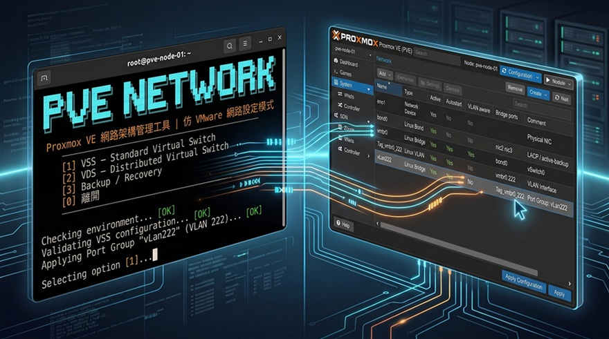

# 02. PVE 網路架構與 VSS / VDS 管理



> **工具：PVE NETWORK PRO**
>
> **GitHub main 版本：2.0.85**
>
> **本機測試版：2.1.6（尚未發布至 GitHub）**
>
> **更新日期：2026-10-14**
>
> **適用環境：Proxmox VE 9.x / Debian 13 Trixie**

`pve_network.sh` 是 PVE Toolkit 的網路架構管理工具。

PVE NETWORK PRO 2.0 的操作模型採 **VMware-first** 設計，使用熟悉的：

- VSS / vSwitch
- VDS / Distributed Switch
- Physical Uplink
- Port Group
- VMkernel / Management

作為使用者操作層；底層實際仍由 Proxmox VE 原生 Linux Network、ifupdown2 與 PVE SDN 負責設定與套用。

---

## 1. 快速執行

直接從 GitHub `main` 執行：

> **覆蓋警告：** 以下命令會覆寫 `/root/pve_network.sh`。本機若已使用尚未發布的測試版，請勿直接執行；應先備份並確認版本差異。目前 GitHub main 腳本為 `2.0.85`，本機 `2.1.6` 不會因本文件更新而自動發布。

```bash
curl -fsSL https://raw.githubusercontent.com/sungshu/Pve-Toolkits/main/src/pve/pve_network.sh -o /root/pve_network.sh
chmod +x /root/pve_network.sh
/root/pve_network.sh
```

執行前會先下載 GitHub main 版本至 `/root/pve_network.sh`，再賦予執行權限後啟動。

---

## 2. 2.0 核心架構

PVE NETWORK PRO 2.0 正式資料根目錄：

~~~text
/etc/pve-toolkit/net/
├── baseline/
├── state/
│   ├── vss/
│   ├── vds/
│   ├── objects/
│   └── topology/
├── backup/
└── recovery/
~~~

**正式禁止使用：**

~~~text
/etc/pve-poc/
~~~

PVE NETWORK PRO 的管理資料與 PVE 原生網路設定分離：

~~~text
PVE NETWORK PRO
      │
      └── /etc/pve-toolkit/net/
              │
              ├── Current / State
              ├── Backup
              ├── Change History
              └── Recovery

PVE Native
      │
      └── /etc/network/interfaces
~~~

PVE NETWORK PRO 不取代 PVE Network Engine。

---

## 3. 網路變更模型

PVE NETWORK PRO 採用直接套用模式，不保留 Proposed Configuration、Change Plan 或獨立的 `/etc/network/interfaces.new`。

每次需要修改 PVE Native Network 時：

```text
目前設定
   ↓
使用者確認變更
   ↓
建立 Change ID
   ↓
自動備份修改前設定
   ↓
語法檢查
   ↓
直接套用 /etc/network/interfaces
   ↓
ifreload -a
   ↓
成功 → 完成
失敗 → 使用 Backup Recovery
```

暫時產生的設定內容只存在於執行期間的暫存檔，成功或失敗後立即清除，不作為管理介面或持久化設定。

### 強制原則

1. 正式變更前一定先建立 Backup。
2. 不保留沒有實際用途的 Proposed Configuration。
3. 不使用獨立的 `interfaces.new` 作為使用者操作介面。
4. 套用失敗必須能使用 Backup Recovery。
5. Baseline 與 Backup History 是主要退路。

## 4. Change ID

每一次 Network Change 都建立唯一 Change ID：

~~~text
CHG-YYYYMMDD-HHMMSS
~~~

Change ID 主要用來命名每次變更前的 Backup 與 Recovery 資料：

~~~text
backup/CHG-YYYYMMDD-HHMMSS/
recovery/
~~~

這樣可以在需要還原時快速找到對應的變更前設定。

---

## 5. 主選單

目前 2.0 操作架構：

~~~text
PVE NETWORK PRO
────────────────────────────────

1) Network Objects
   ├─ Virtual Switch / VSS
   │  ├─ Physical Uplink
   │  ├─ Port Group
   │  └─ VMkernel Adapter / Management
   └─ Distributed Virtual Switch / VDS
      └─ Port Group

 3) Backup / Recovery 備份/還原管理中心
   ├─ 1) 建立手動 Backup
   ├─ 2) 從既有 Backup 還原網路設定
   └─ 3) Baseline 還原最初設定

0) Exit
~~~

UI 使用 VMware 網路模型作為主要語言；PVE / Linux 實作細節則作為底層資訊。

---

## 6. VSS / vSwitch

VSS 是 Standard Virtual Switch 的操作模型。

> **PVE / VMware 角色對照：** `vmbr0` 這類 Linux Bridge 對應 VMware 的 **Standard vSwitch / VSS**；如果該 Bridge 上掛有管理 IP，該 IP 的角色才對應 VMware 的 **VMkernel Adapter / Management**。Linux Bridge 本身不是 VMkernel。PVE Linux Bridge 名稱也不強制使用 `vmbrX`，實際環境可以使用 `vswitch3` 等合法 Linux bridge 名稱。

VMware 概念：

~~~text
vSwitch0
├── Physical Uplink
│   ├── NIC
│   └── NIC Teaming
├── Port Group
└── VMkernel / Management
~~~

PVE 實作對應：

| VMware 概念 | PVE NETWORK PRO | PVE 實作 |
|---|---|---|
| vSwitch | VSS | Linux Bridge（名稱不固定為 vmbrX） |
| Physical Uplink | Uplink | NIC / Bond |
| NIC Teaming | Uplink Teaming | Linux Bond |
| Port Group | Port Group | Bridge + VLAN 邏輯 |
| VMkernel | VMkernel / Management | PVE Host Management |

### Uplink

VSS 建立與 Uplink 管理分離。

可使用：

- 單一 Physical NIC
- Active / Standby
- LACP
- Load Balance

工具不應假設固定的：

~~~text
nic2
nic3
bond0
~~~

實際 NIC、Bond 與 Bridge 應由目前系統 topology 決定。

### Physical Uplink 移除與 Bond 交接（本機測試版）

本輪補回 VSS 下的 Physical Uplink 移除操作，與新增流程對應；不是刪除實體 NIC，也不是刪除父 Virtual Switch。

Bond 改接單 NIC 的流程：

1. 列出目前 Virtual Switch、PVE Bridge 與既有 Uplink，檢查拓樸及依賴。
2. 確認前選定保留 NIC，顯示 Bond 模式、作用中 NIC、成員狀態、操作前後結果與短暫斷線風險。
3. 使用者確認後再次核對 Bond 成員；狀態改變便停止操作。
4. 建立候選設定與變更前 Backup，套用後執行 Runtime 交接。
5. 確認 Bridge 已改接指定 NIC、原 Bond 已移除，再驗證管理網路、Default Gateway 與 Cluster。

此操作保留父 Virtual Switch / PVE Bridge 與 Port Group，不修改 VM／CT 設定；VM／CT 引用不應作為 Bond 改接單 NIC 的阻擋依據。管理與 Cluster 驗證仍保留，不能把保留 IP 解讀為切換無中斷。

`2.1.6` 將不支援的「單 NIC → 無實體出口」阻擋提示提前；此路徑尚待實機回歸，不宣告已通過。

---

## 7. VSS Port Group

VSS Port Group 主要描述：

- Port Group Name
- VLAN ID
- 用途
- 所屬 VSS / vSwitch

例如：

~~~text
vLan_201
    VLAN ID: 201
    Type: Virtual Machine
~~~

Port Group 名稱與 VLAN ID 必須由操作者明確指定。

不可單純因為：

~~~text
vnet100
~~~

就推測：

~~~text
VLAN 100
~~~

### Port Group 刪除（本機測試版）

本輪補回 VSS Port Group 刪除操作，使建立與刪除流程對應。刪除確認前應列出目前 Port Group、VLAN／介面、父 Virtual Switch／PVE Bridge 與 VM 網路 Bridge 對應，供操作者確認目標；保留父 Virtual Switch，並保護仍被其他物件共用的 VLAN Interface。

VM／CT 設定引用僅作提醒：列出引用設定檔，說明不自動解除引用、不修改 VM／CT 設定，且不單憑引用阻擋刪除。引用提醒不代表 Guest 連通性已驗證。

中間測試曾出現個別 Port Group 無法刪除、但可從 GUI 刪除的情況；GUI 刪除後 State 一致性與各種 Port Group 刪除情境仍待完整回歸，不以本次 Bond 成功作為全面修復證據。

---

## 8. VDS / Distributed Switch

VDS 使用 Proxmox VE SDN 作為底層實作。

概念：

~~~text
VDS
├── Zone
├── VNet
├── Subnet
└── Port Group
~~~

PVE 對應：

~~~text
VDS
 ↓
SDN Zone
 ↓
VNet
 ↓
Subnet
~~~

VDS / SDN 物件必須區分：

- 本工具建立的物件
- 系統原本已存在的物件

Recovery 不應盲目刪除外部既有的 SDN Zone / VNet。

---

## 9. Baseline

Baseline 是第一次正式管理前的已知正常狀態。

正式位置：

~~~text
/etc/pve-toolkit/net/baseline/
~~~

Baseline 建立後不應因一般變更自動覆蓋。

Baseline 與 Change Backup 是不同概念：

| 類型 | 用途 |
|---|---|
| Baseline | 正式管理前的初始正常狀態 |
| Backup | 每一次正式 Change 前的即時狀態 |
| Recovery | 發生失敗後的還原流程 |

---

## 10. Backup

每次正式 Apply 前建立 Change Backup。

位置：

~~~text
/etc/pve-toolkit/net/backup/CHG-YYYYMMDD-HHMMSS/
~~~

至少保留與網路變更相關的狀態，包括：

~~~text
interfaces
ip-address
ip-route
ip-link
cluster-status
~~~

Backup History 可用來查看過去的 Change Backup。

---

## 11. Rollback / Recovery

Recovery 的目的只有一個：使用已保存的 Backup / Baseline 恢復網路設定。

一般流程：

~~~text
Recovery Request
      ↓
建立 Change ID
      ↓
Backup Current State
      ↓
直接套用保存的設定
      ↓
ifreload -a
      ↓
Verify
~~~

如果 Recovery 套用失敗，使用同一 Change ID 的 Backup 再次恢復。

### VSS Recovery

還原 VSS 變更前的設定。套用時會先建立目前設定的 Backup，然後直接套用保存的 VSS 設定。

### VDS Backup Recovery

Change Backup 會保存建立當下的 `/etc/pve/sdn.cfg` 快照；一般 Backup History Recovery 目前只還原 `/etc/network/interfaces` 與工具 State，不會套用 SDN 快照。VDS 專用 Backup Recovery 尚未接回目前選單，因此不能把已保存的 SDN 快照視為已具備一鍵還原功能。

### Baseline Recovery

將 Baseline 直接套用到 `/etc/network/interfaces`。套用前會先建立目前設定的 Backup。

---

## 12. PVE Native Network 套用

PVE Native Network 的正式設定只有：

```text
/etc/network/interfaces
```

PVE NETWORK PRO 不再建立或保存 `/etc/network/interfaces.new`。

VSS / Port Group 等操作會在執行期間產生暫時檔案，完成套用後立即刪除。真正的設定、Backup 與 Recovery 仍以正式檔案及 Backup History 為準。

因此不會留下「已產生但尚未套用」的 Proposed Configuration，也不需要另外提供 Proposed Apply 功能。

## 13. State 與 Topology

2.0 State 用來描述目前有效的 Network Object / Topology。

State 必須支援：

- get
- set
- upsert
- delete

Topology 必須從系統目前狀態解析。

基本關係：

~~~text
vmbr
 ↓
bridge-ports
 ↓
bondX / nicX
 ↓
bond-slaves
 ↓
Physical NIC
~~~

因此不得將：

~~~text
bond0
~~~

視為固定名稱。

---

## 14. Cluster 安全檢查

進行正式網路變更前，工具應確認：

- PVE Cluster 已加入
- Cluster Quorum 正常

網路變更涉及：

- Management Bridge
- Management IP
- Gateway
- Host Network
- Uplink

時，必須視為 Management Impact Change，不能只當成一般 VM Network 修改。

---

## 15. Network Status

Network Status 用於查看目前系統狀態，包括：

- PVE Node
- PVE Version
- Cluster / Quorum
- Default Gateway
- Management IP
- Physical NIC
- Link State
- Link Speed
- Linux Bridge
- Bond / Uplink
- SDN Zone
- VNet / Port Group
- Current Network Configuration
- Connectivity

Status 顯示的是目前系統實際狀態，而不是只讀工具自己的 State。

---

## 16. Network Change Safety

### SAFE

- 修改前自動建立 Backup。
- 使用既有的 Backup / Recovery。
- VSS Port Group 刪除會保護共用 VLAN Interface。
- VDS Recovery 只處理本工具建立的 SDN 物件。

### CAUTION

- Management Bridge、Gateway、Physical Uplink 變更仍可能中斷 SSH。
- `ifreload -a` 會實際套用網路變更。
- Recovery 前仍應確認 Cluster / Quorum 狀態。

### MANAGEMENT IMPACT

涉及目前管理介面的變更必須明確確認，並確保已有可用 Backup。

## 17. PVE 網路注意事項

PVE NETWORK PRO 實際操作的底層元件包括：

~~~text
/etc/network/interfaces
ifupdown2
PVE SDN
~~~

正式環境執行前應確認：

- 目前 Management IP
- Default Gateway
- Physical NIC Link
- Bond / LACP
- VLAN
- VM / CT 網路
- Ceph 網路
- Cluster Quorum
- 目前 `/etc/network/interfaces`
- Baseline

尤其 Management Network、Ceph Network 與 VM Network 如果共用 Physical Uplink，變更前必須先確認目前 topology。

---

## 18. 工具範圍

### 包含

- VSS / vSwitch
- VDS / Distributed Switch
- Physical Uplink
- NIC / Bond
- Port Group
- VLAN
- PVE SDN
- SDN Zone
- VNet
- Baseline
- Backup
- Recovery
- Network Status
- Cluster / Connectivity Check
- GitHub 最新版本檢查

### 不包含

- PVE Cluster 建置
- Ceph Cluster / OSD 建置
- VM / CT Migration
- Storage Cluster
- HA 架構建立
- Firewall 規則管理
- VMware Cluster Migration

---

## 19. 腳本位置

~~~text
src/pve/pve_network.sh
~~~

GitHub：

~~~text
https://github.com/sungshu/Pve-Toolkits
~~~

Raw：

~~~text
https://raw.githubusercontent.com/sungshu/Pve-Toolkits/main/src/pve/pve_network.sh
~~~

---

## 20. 版本紀錄

以下依版本由新至舊排列；版本標題統一使用 `v主版.次版.修正版`，日期採 YYYY-MM-DD。僅記錄目前可核對的版本，不推測缺少的中間版本內容。

### v2.1.6 — 2026-10-14（本機實測版，尚未發布至 GitHub）

- 本輪補回 VSS 下的 Port Group 刪除與 Physical Uplink 移除操作，讓新增與移除流程對應；操作前列出既有拓樸、目標及保留項目。此為本輪整體修正摘要，不將功能恢復時間硬指定為本版才首次實作。
- Port Group 移除時，VM／CT 設定引用僅列為提醒，不自動解除引用或修改 Guest 設定；各種刪除情境仍待完整回歸驗證。
- 以本機 `2.1.5` 為基礎原地修補；修復工具先檢查版本與函式片段，檢查通過後才備份並替換主程式，不從舊版重建或整份覆蓋。
- Physical Uplink 移除前預先選定保留 NIC，顯示操作前後 Bridge / Uplink、Bond 模式、作用中介面與成員狀態；確認後再次核對 Bond 成員，再執行候選設定、Runtime 交接及結果驗證。
- Bond 移除完成後保留原 PVE Bridge 與 Port Group，將 Bridge 改接指定單 NIC；驗證管理網路、Default Gateway 與 Cluster Quorum。
- 統一 Bond 狀態顯示，涵蓋模式、作用中 NIC、連線狀態與成員；訊息改用「拓樸／依賴檢查」等精確描述，區分設定套用、Runtime 交接及 Guest 連通性。
- 將不支援的「單 NIC → 無實體出口」阻擋提示提前，避免確認後才拒絕操作；此路徑尚待實機回歸。
- 本機實測 `active-backup` 的 `bond0 → nic2` 交接成功，`vmbr0` 與既有 Port Group 拓樸保留，管理網路及 Cluster Quorum 驗證正常。
- 尚未全面驗證 Guest 實際連通性、切換掉包或中斷時間、其他六種 Bond 模式、單 NIC 移除提前阻擋、GUI 刪除後狀態一致性及各種 Port Group 移除情境；不得將本次結果解讀為全面回歸完成。
- 本機修補後 SHA256：`9a3699c41c2b109aea6d6be51f9b4337edd24a10ac4a3606f4891fe08cdf8814`；本機檔案大小由 212,614 增至 212,905 bytes，淨增加 291 bytes。此版本尚未推送，GitHub 腳本仍為 2.0.85。

#### 修復工具交付與修正紀錄

- 原地修補流程要求本機版本為 `2.1.5`，且預期函式片段符合；候選檔通過 Bash 及可辨識的內嵌 Python 語法檢查後才備份與替換。修復工具本身不執行網路套用。
- 首次檢查因多行函式解析器不支援單行 `log_info()` 函式而中止；中止發生於主程式替換前。更正檢查範圍後重新執行，完成 `2.1.5 → 2.1.6` 升級。
- 本段記錄升級工具的修正，不將其誤列為主程式 `v2.1.5` 的獨立功能變更。

### v2.0.88 — 2026-10-14（本機安全測試基準）

- 停用自動替換，避免本機測試修正被較舊 GitHub 腳本覆蓋。
- 曾成功建立 `vLan050` / VLAN 100，VLAN 介面為 `Tag_vmbr0_100`，Virtual Switch 為 `vSwitch0`，PVE Bridge 為 `vmbr0`；該次建立 Runtime、管理網路與 VM Bridge 驗證通過，但不代表 GUI 刪除後狀態一致性已全面修復。
- 中間測試曾發現 GUI 刪除後 State 可能殘留、個別 Port Group 移除失敗及 Physical Uplink NIC / Bond 交接問題；不可將該階段描述為全面通過。

### v2.0.85 — 2026-10-13

- 複核 VSS 新增介面的預檢提示處理：僅忽略本次新增、尚未出現在 Runtime，且同時有 `auto` 與 `iface` 設定的介面警告；其他預檢錯誤仍會阻止套用。

### v2.0.84 — 2026-10-13

- 新增 VSS Port Group 時，預檢若指出本次新增、設定完整但尚未建立於 Runtime 的介面，會辨識為預檢提示；其他預檢錯誤仍會阻止套用。

### v2.0.83 — 2026-10-13

- GUI 刪除 Port Group 後若留下孤立 Runtime Bridge，建立同名 Port Group 時會檢查 Bridge Port；仍有其他連接埠便拒絕清理，只有孤立狀態才經確認清除 Runtime 與舊 State。
- 套用與 Recovery 會補齊 PVE SDN 載入指示，並將舊設定中的 `bridge-fd 0` 正規化為合法值，降低 ifupdown2 警告造成套用失敗的機會。
- VSS 目前設定畫面的過期 State 提示移至 Management / Host Network 區塊下方，與 Port Group 清單分開。

### v2.0.17 — 2026-10-01

- Linux Bridge 不再強制使用 `vmbrX` 命名，可使用 PVE 實際存在的合法 Bridge 名稱。
- 分開呈現 VSS、Physical Uplink 與 VMkernel / Management 角色；管理 IP / Gateway 對應 VMkernel / Management。
- VSS 查看改由 Runtime Bridge topology 解析 Physical Uplink，正確顯示單一 NIC 與 Bond。
- 修正 VSS「查看」重複等待 Enter 的問題。
- 新增 PVE GUI Pending Network Configuration 安全閘門；存在 `/etc/network/interfaces.new` 時停止工具的正式網路套用。

### v2.0.16 — 2026-10-01

- 修正 VSS 的 VMkernel / Management 選項呼叫未定義函式，補回唯讀資訊檢視。
- VSS 選單整理為 VMware 操作順序：Virtual Switch → Physical Uplink → Port Group → VMkernel / Management → 查看。
- 移除舊式中間選單，避免操作層級重複。
- VMkernel / Management 僅顯示 Management Device、IP 與 Gateway，不直接修改管理網路。
- 作為實機 UI 回歸測試版本。

### v2.0.15 — 2026-10-01

- 以已驗證的 2.0.10 為基礎重建，清除 2.0.11 至 2.0.14 的重複程式碼污染。
- Network Objects 改為 VMware-first；VSS 與 VDS 各自管理 Uplink、Port Group 與查看功能。
- VDS Port Group 改為實際建立與刪除 SDN VNet。
- 網路變更共用 Backup 檢查，並補強 Uplink NIC 衝突檢查。
- 修正 VSS VLAN 刪除判斷、Uplink 驗證失敗 Recovery 與 Emergency Recovery 的 Quorum 限制。
- Change Backup 增加 State snapshot。
- GitHub 自動更新只在使用者確認新版後覆寫本機腳本。

### v2.0.14 — 2026-10-01

- 清除重複的 `network_backup_exists()`、`vds_configure()` 與 `main_menu()` 定義，保留單一主入口。

### v2.0.12 — 2026-10-01

- 修復 Bash 語法錯誤與重複尾段，恢復單一 `main "$@"` 入口。
- 移除重複的 `vds_configure()`，補回 VDS Port Group / VNet 建立與刪除流程。
- VSS Uplink 僅修改目標 Bridge 所屬 Bond / Uplink，並在選 NIC 前檢查使用衝突。
- 修正 VSS Port Group 刪除時的 VLAN 使用判斷。
- 驗證失敗時補上 VSS Uplink Recovery；Emergency Recovery 不再受 Quorum Guard 阻擋。
- Change Backup 同步保存 State snapshot。
- GitHub 更新流程改為只在確認新版後覆寫本機腳本。

### v2.0.11 — 2026-10-01

- Network Objects 僅保留 VSS 與 VDS。
- VSS / VDS 各自直接管理 Uplink、Port Group、Management 或查看功能，移除多層及頂層重複選單。
- 網路變更前共用 Backup 檢查；已有有效 Baseline / Backup 時直接使用，沒有時才詢問建立。

### v2.0.10 — 2026-10-01

- 修正 VSS Uplink 套用時區域變數失效，造成 `set -u` 的 `unbound variable`。
- 改用共用的 `GENERATED_INTERFACES_FILE` 傳遞暫存設定。
- 成功或失敗後清理暫存檔並重設狀態。
- 同步工具與文件版本。

### v2.0.7 — 2026-10-01

- 移除 Proposed Configuration、Change Plan 與 Change Management 流程。
- 不再持久化 `/etc/network/interfaces.new`；網路變更改為直接套用正式設定。
- 保留變更前自動 Backup 與失敗 Recovery；暫存設定於執行後清除。

### v2.0.6 — 2026-10-01

- VSS Port Group 刪除增加「全部刪除」，以單一 Change Transaction 處理。
- 修正共用 VLAN Interface 時刪除單一 Port Group 不應誤刪共用介面的問題。

### v2.0.5 — 2026-10-01

- 修正 VSS Recovery 後 Runtime Port Group / VLAN Interface 可能殘留的問題。
- Recovery 成功後同步校正 VSS State 與還原後的網路設定。
- 僅清理本工具追蹤且已不在還原設定中的物件。

### v2.0.4 — 2026-10-01

- VSS 與 VDS Port Group 選單統一為「建立 → 刪除 → 查看」，符合 VMware-first 操作順序。

### v2.0.0 — 2026-10-01

- 正式導入 `/etc/pve-toolkit/net/`，移除 `/etc/pve-poc/` 架構。
- 建立 Network Object、State、Backup、Recovery 分層與 Change ID。
- VSS 變更、VSS Recovery 與 Baseline Recovery 改由統一 Backup / Recovery 流程處理。
- 新增 Backup History，強化 Rollback、State Upsert 與 VMware-first UI。
- 建立 VSS / VDS / Port Group / Uplink 分層及 Topology-oriented 設計。

### v1.1.3 — 2026-09-30

- 整理 VSS / VDS / Uplink 與 Network Object 操作選單。
- 加入 Port Group 管理、Cluster / Quorum 檢查、網路狀態顯示與版本檢查。

### v1.0.1 — 2026-09-30

- 主畫面顯示工具版本與更新日期。
- 啟動時檢查 GitHub Raw 最新版本，主選單增加版本檢查。

### v1.0.0 — 2026-09-30

- PVE NETWORK PRO 初版，提供 VSS / Linux Bridge、Bond、VDS / PVE SDN、Port Group / VNet、Baseline、Rollback 與網路狀態檢查。

---

## 21. 操作畫面

以下為 `img/p02/` 的 16 張操作截圖，依檔名時間排序；保留原始檔名，以相對路徑引用，檔名中的空白以 `%20` 編碼。圖片僅作操作畫面紀錄，不擴大第 20 節列出的實測通過範圍。

### 21.1 2026-10-14 15:55:07


### 21.2 2026-10-14 15:55:08


### 21.3 2026-10-14 15:56:14


### 21.4 2026-10-14 15:59:15


### 21.5 2026-10-14 16:00:49


### 21.6 2026-10-14 16:01:21


### 21.7 2026-10-14 16:02:28


### 21.8 2026-10-14 16:02:53


### 21.9 2026-10-14 16:02:53（-1）


### 21.10 2026-10-14 16:03:20


### 21.11 2026-10-14 16:03:43


### 21.12 2026-10-14 16:06:57


### 21.13 2026-10-14 16:07:35


### 21.14 2026-10-14 16:07:42


### 21.15 2026-10-14 16:07:51


### 21.16 2026-10-14 16:08:32


